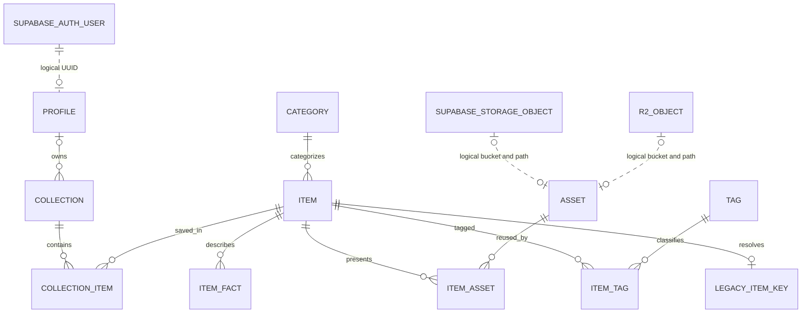

# Catalog entity model

The catalog belongs in **Neon**. **Supabase** remains the authority for users,
sessions, and authentication. Media can live in Supabase Storage or Cloudflare R2; Neon stores
its bucket/path reference. Existing externally hosted artwork remains supported.
There is no second copy of passwords, sessions, or auth users in Neon.

The application reads the canonical catalog through `server/services/catalog.service.ts`.
Home, search, `/api/catalog`, and item details use catalog entities. Item URLs are
`/items/{categorySlug}/{itemSlug}`; titles are display text only. Published items
in active categories are the only content returned, even with an owner connection.
There is no legacy runtime fallback or demo bootstrap command.



## Entities and the current design

| Entity | Purpose | Current screen |
| --- | --- | --- |
| `categories` | Slug, display name, description, icon key, accent, artwork style, display order, active flag | Category doors, search filters, breadcrumbs |
| `items` | Stable ID, slug, title, summary, description, category, publication state, featured flag, ordering | Archive cards, spotlight, detail heading and about section |
| `item_facts` | Ordered key/label/value facts | `Resolution / 4K`, `Tracks / 8 tracks`, `Platform / Windows` |
| `assets` | Reusable external, Supabase Storage, or R2 reference; optional dimensions, duration, size | Artwork, audio/video previews, future downloads |
| `item_assets` | Media role, alt text, crop focal point, display order | One cover per item, preview and download attachments |
| `tags`, `item_tags` | Many-to-many labels across categories | Cozy, night, chaos, future mood discovery |
| `collections`, `collection_items` | Ordered saved, custom, or editorial groups | Your collection, future named lists and curated shelves |
| `content_uses`, `item_uses` | Multiple intended uses per item | Wallpaper, background and avatar without duplicate uploads |
| `profiles` | Supabase UUID, unique lowercase username, display name, avatar URL, application role | Account and collection ownership |

Content IDs use `bigint GENERATED ALWAYS AS IDENTITY`; expose them as
decimal strings in JSON/TypeScript to avoid JavaScript's integer precision limit.
Profile/owner IDs use the Supabase `uuid` without generating a second identity.
Timestamps use `timestamptz`. Titles are editable and are neither primary keys
nor unique identifiers. Item slugs use `UNIQUE(category_id, slug)`; category slugs
are globally unique. URLs include both category and item slugs
(for example `/items/music/night` and `/items/wallpapers/night`) or a stable item
ID. Never resolve an item by its slug alone. Keep slugs stable after publication.

Each item has one primary category; tags provide cross-category classification.
Add a secondary-category join table only when the product needs multiple category
placement. Category names are **not** database enums or TypeScript unions.

## Adding a category

An administrator inserts a category, then items referencing its ID. No table or
check-constraint change is needed. For example, fonts can use the existing image
artwork style and facts for weights, formats, and license:

```sql
INSERT INTO catalog.categories (slug, name, description, icon_key, sort_order)
VALUES ('fonts', 'Fonts', 'A little character for your next project.', 'type', 3);

INSERT INTO catalog.items (category_id, slug, title, summary)
SELECT id, 'soft-serif', 'Soft Serif', 'A typeface for quiet little projects.'
FROM catalog.categories WHERE slug = 'fonts';

INSERT INTO catalog.item_facts (item_id, key, label, value, sort_order)
SELECT id, 'weights', 'Weights', '6 weights', 0
FROM catalog.items WHERE slug = 'soft-serif';
```

New items default to draft. Publishing requires `status = 'published'` and a
non-null `published_at`. Deactivating a category hides its items from runtime
reads. The timestamp records publication; it is not a scheduled-publication job.

Facts are display data, so never parse `8 tracks` or `326 MB` for business logic.
Use the item's JSON object `metadata` for optional machine-readable extensions
such as `{"track_count": 8}`. `lib/entities/metadata.ts` provides strict Zod
schemas selected by the category's persisted `metadata_schema_key`:

| Key | Optional machine-readable fields |
| --- | --- |
| `images.v1` | `width` + `height`, `image_count`, image `formats` |
| `music.v1` | `track_count`, `duration_seconds`, audio `formats` |
| `games.v1` | `size_bytes`, `platforms`, `version` |
| `generic.v1` | No custom fields; safe default for a new category |

Unknown schema keys/fields, wrong types, negative counts, fractional counts,
unsafe integers, and incomplete image dimensions are rejected. Imported legacy
snapshots are removed and rejected by the current schemas. Fields remain optional
so draft content and migrated rows do not need fabricated technical metadata.

`server/services/catalog-metadata.ts` validates updates after reading and locking
the actual item's category; the caller must supply one trusted connection inside
a transaction. This is an internal admin write helper, not a public endpoint or
an authorization bypass. Future insert/category-change services must call the
same parser before writing. Changing `metadata_schema_key` requires validating
all existing items before committing that category change.

Zod runs in the application, not inside Postgres. Direct administrative SQL can
bypass it; route application writes through the service, and validate imports
before loading them. The database still enforces that metadata is a JSON object.
Adding a category using generic facts needs no code; adding new structured JSON
fields requires registering a versioned Zod schema and selecting its key.

Promote attributes to typed columns or a dedicated detail table when they need
range filters, indexes, relationships, or stronger constraints. Do not build an
untyped relationship model inside JSON. Intended uses belong in `item_uses`.

The frontend loads active categories from Neon and filters by category slug.
Facts render their stored labels and values; accent colors and cover focal points
are applied as styles. The generic detail layout supports new category rows.

## Hybrid ownership and access

`catalog` is private to the app server. Do not expose it through Supabase's Data
API or configure a browser to query Neon directly. No Supabase database migration
is required for this model.

- `profiles.id` logically references Supabase `auth.users.id`; the cross-provider
  reference cannot be a foreign key. `collections.owner_user_id` now has a real
  Neon FK to `profiles.id`, with cascade deletion of collections/memberships.
- Provision a profile only after verifying the Supabase identity. Use the verified
  UUID, default role `member`, and `ON CONFLICT (id) DO NOTHING` for retry-safe
  onboarding. Never import a role from user metadata. Existing collection owners
  get placeholder profiles during upgrade; no Supabase account is created.
- Usernames are nullable until chosen, otherwise lowercase `[a-z0-9_]{3,32}` and
  unique. Profiles are owner-readable, not publicly enumerable. Runtime users may
  update username, display name, and avatar; they cannot change their ID or role.
  A trigger also blocks role escalation if someone accidentally grants full UPDATE.
  Role changes use a trusted admin service and the separate privileged DB role;
  application `admin` is not a Postgres role or an automatic RLS bypass.
- The server must verify the Supabase session using `auth.getClaims()`, check the
  error and `data?.claims?.sub`, and use that verified UUID. Never trust an owner
  ID, JWT decoded without verification, or editable user metadata from a client.
- On the **same connection and transaction** as a private Neon query, call
  `SELECT set_config('app.user_id', $1, true)` with the verified subject. The last
  argument makes the value transaction-local; it must not leak through pooling.
  Keep explicit owner predicates in write queries as well as RLS.
- The runtime connection must use a non-owner, `NOSUPERUSER`, `NOBYPASSRLS` role.
  RLS is enabled on every catalog table. Table owners are intentionally reserved
  for migrations and trusted content administration, including editorial groups
  and account-deletion cleanup. An owner connection is not a safe runtime role.
- Public reads include active categories and published items, plus their facts,
  media, tags, and legacy keys. Private or unpublished media references are hidden.
- Saved collections are private, limited to one per user, and cannot have
  duplicate items. Custom collections can be explicitly made public; public
  visibility never grants someone else write permission. Editorial collections
  have no user owner and cannot be created or modified by the runtime role.

Provision a separate runtime login using your deployment's secret management.
These grants belong on that role (replace `pixinium_runtime` with its name):

```sql
GRANT USAGE ON SCHEMA catalog TO pixinium_runtime;
GRANT SELECT ON ALL TABLES IN SCHEMA catalog TO pixinium_runtime;
GRANT INSERT ON catalog.profiles TO pixinium_runtime;
GRANT UPDATE(username, display_name, avatar_url) ON catalog.profiles TO pixinium_runtime;
GRANT INSERT, UPDATE, DELETE ON catalog.collections, catalog.collection_items TO pixinium_runtime;
GRANT USAGE ON SEQUENCE catalog.collections_id_seq TO pixinium_runtime;
```

No runtime grants or login credentials are created automatically. Keep
`DATABASE_URL_UNPOOLED` for the migration/admin role, and use a separately
provisioned pooled runtime credential for catalog application queries.

Account deletion needs an idempotent server-side cleanup workflow: revoke the
Supabase sessions, delete the user's Neon profile (collections/memberships cascade), then
delete their Supabase identity. Track failures durably and retry; reconcile users
deleted directly through the Supabase dashboard as well. Do not assume deleting
an auth user invalidates already-issued access tokens. Strict revocation-sensitive
operations need an additional live user/session check.

## Media lifecycle

An asset has exactly one location: an external HTTPS URL **or** a bucket and
object path under provider `supabase` or `r2`. The unique storage index includes
`(provider, bucket, object_path)` so providers can share names without collision.
One configured account per provider is assumed; keep account endpoints and keys
in server configuration, not asset rows. Store neither file bytes nor expiring signed URLs in Neon.
Generate signed URLs per request for private objects after authorization; public
preview assets may use public buckets. Provider-specific URL resolvers, credentials,
Storage policies/R2 permissions, and buckets remain separate work and must match
the intended media visibility. Adding `r2` here does not provision an R2 account.

Deleting an item deletes its asset attachments, not shared assets or remote
objects. Deleting a referenced asset is restricted. A maintenance job may remove
unreferenced assets and their remote files after a retention window. Upload and
deletion operations span providers, so use retries and orphan cleanup instead
of pretending there is one cross-provider transaction.

## Migration and runtime

Run `pnpm db:migrate` with a direct `DATABASE_URL_UNPOOLED` after testing on an
isolated branch. Existing migration files remain immutable history: they can
backfill existing archive rows, while a fresh database needs no demo data.
The app requires migrations 0001 through 0005 and queries only `catalog.*`.

The old `/api/archive` endpoint and title-based item URLs are removed.
Migration 0005 drops `public.archive_items` and `catalog.legacy_item_keys`, removes
legacy metadata, and renames Wallpapers to Images. Old wallpaper URLs are not redirected.
Legacy examples live exclusively in test fixtures for backfill regression tests.

Saved items remain guest, device-local favorites, now keyed by canonical item IDs
under `pixinium:saved-catalog-ids`. Old title-based localStorage is not read or
converted. No authenticated cloud-save workflow is introduced.

External HTTPS media URLs are supported directly. For public storage objects,
set `CATALOG_PUBLIC_ASSET_ORIGINS` to a JSON map of `provider:bucket` to an HTTPS
bucket base URL. Missing origins fail explicitly; no placeholder artwork or fake
content is substituted. Private objects require a signed-URL resolver before use.

The local suite uses PGlite to execute real Postgres SQL and checks backfill,
fresh installs, repeatability, rollback, constraints, new categories, private
ownership, public sharing, hidden drafts/assets, and transaction-local identity.
It does not substitute for testing Neon branch permissions or Supabase Storage.

## Database audit (2026-10-22)

A read-only inspection of the configured Neon database confirmed:

- Only `public.archive_items` currently exists. No catalog or migration ledger
  has been deployed, so the changes above remain staged.
- The live table has a title primary key, a three-category CHECK, and only the
  primary-key index. The new model addresses those identity/category limits.
- The current connection uses `neondb_owner` with `BYPASSRLS`. Replace the runtime
  credential with a restricted role before enabling private profiles/collections;
  merely adding RLS policies while keeping that credential does not isolate users.
- No private data tables or policies were present. The inspection queried system
  catalogs only and did not modify data or inspect personal records.

Repeat the schema/role inspection with `pnpm db:audit`. Deployment and credential
provisioning have not been performed as part of this schema revision.

Provider references:
[Supabase server identity](https://supabase.com/docs/guides/auth/server-side/creating-a-client),
[Neon serverless transactions](https://neon.com/docs/serverless/serverless-driver),
[PGlite local Postgres](https://pglite.dev/docs/).
